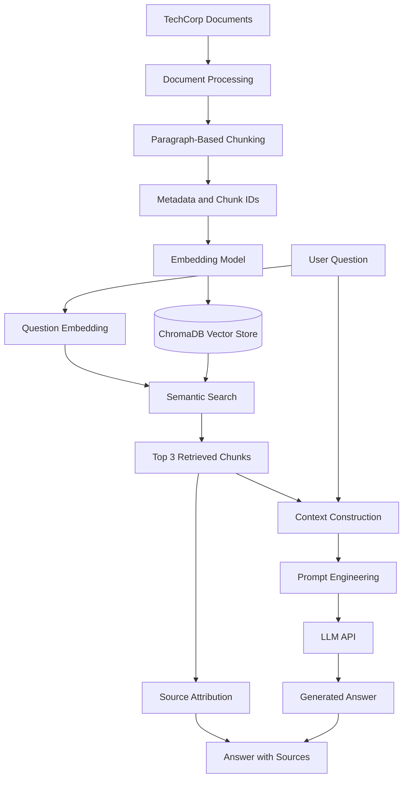

# RAG Revolution — Retrieval-Augmented Generation

A hands-on implementation of a Retrieval-Augmented Generation (RAG) pipeline using Python, ChromaDB, Sentence Transformers, and an OpenAI-compatible LLM API.

This project demonstrates how to process internal documents, convert text into embeddings, retrieve relevant information using semantic search, and generate context-grounded answers with source attribution.

## Table of Contents

- [Overview](#overview)
- [Architecture](#architecture)
- [Technology Stack](#technology-stack)
- [Project Structure](#project-structure)
- [Prerequisites](#prerequisites)
- [Environment Configuration](#environment-configuration)
- [Installation and Execution](#installation-and-execution)
- [Implementation Details](#implementation-details)
- [Sample Results](#sample-results)
- [Limitations and Future Improvements](#limitations-and-future-improvements)
- [Key Learnings](#key-learnings)

## Overview

Traditional Large Language Models (LLMs) generate answers using information learned during training and the context provided in a prompt. They do not automatically have access to an organization's private documents or internal policies.

RAG addresses this limitation by retrieving relevant information from an external knowledge base and supplying it to the LLM at inference time.

This project implements a document-based question-answering system for fictional company TechCorp.

The system can answer questions about:

- Remote work policies
- Vacation and leave policies
- Platform capabilities
- VPN troubleshooting

When the available documents do not contain the requested information, the system is instructed to acknowledge that limitation rather than invent an answer.

### Project Objectives

1. Build a persistent vector store.
2. Process documents and divide them into overlapping chunks.
3. Generate embeddings for semantic retrieval.
4. Integrate an LLM through an OpenAI-compatible API.
5. Engineer prompts that constrain answers to retrieved context.
6. Combine retrieval, augmentation, generation, and source attribution into a complete RAG pipeline.

## Architecture

The application follows a straightforward RAG architecture.



### End-to-End Flow

1. **Document ingestion:** Read Markdown documents from the TechCorp document directory.
2. **Chunking:** Split documents into smaller text chunks and include overlapping context.
3. **Embedding:** Convert text chunks into numerical vectors using `all-MiniLM-L6-v2`.
4. **Storage:** Persist the vectors, text, and metadata in ChromaDB.
5. **Query embedding:** Convert the user's question into an embedding using the same model.
6. **Retrieval:** Search ChromaDB for the three nearest chunks.
7. **Augmentation:** Insert retrieved text and the original question into a structured prompt.
8. **Generation:** Send the prompt to the configured LLM API.
9. **Source attribution:** Display the source filenames associated with the retrieved chunks.

## Technology Stack

| Technology | Purpose |
|---|---|
| Python | Application logic and pipeline orchestration |
| ChromaDB | Persistent vector storage and similarity search |
| Sentence Transformers | Local text and query embedding generation |
| `all-MiniLM-L6-v2` | Embedding model producing 384-dimensional vectors |
| OpenAI-compatible API | LLM inference |
| `langchain-openai` | Chat model integration through `ChatOpenAI` |
| `python-dotenv` | Loading environment variables |
| Markdown | Source documents and company policies |

## Project Structure

```text
RAG_Revolution/
├── README.md
├── verify_environment.py
├── task_1_setup_vectorstore.py
├── task_2_document_processing.py
├── task_3_llm_integration.py
├── task_4_prompt_engineering.py
├── task_5_complete_rag.py
├── techcorp-docs/
│   ├── policies/
│   │   ├── remote_work.md
│   │   └── vacation_policy.md
│   ├── products/
│   │   └── techcorp_platform.md
│   └── support/
│       └── vpn_troubleshooting.md
├── chroma_db/
│   └── Persistent vector database files
└── markers/
    ├── task1_setup_complete.txt
    ├── task2_processing_complete.txt
    ├── task3_llm_complete.txt
    ├── task4_prompt_complete.txt
    └── task5_rag_complete.txt
```

**Note:** `chroma_db/` and `markers/` are generated locally when the tasks run. The `.env` file is stored in the parent `langchain-lab/` directory rather than inside `RAG_Revolution/`.

## Prerequisites

- Python and a working virtual environment.
- Access to the Hugging Face Hub for the initial embedding-model download.
- An API key and compatible endpoint for the configured LLM.
- The Python packages used by the scripts.

The embedding model runs locally after its weights have been downloaded. LLM inference uses the configured API endpoint and may incur API charges.

## Environment Configuration

The project loads environment variables from the parent directory.

Expected structure:

```text
langchain-lab/
├── .env
└── RAG_Revolution/
    ├── task_1_setup_vectorstore.py
    ├── task_2_document_processing.py
    └── ...
```

Configure the root `.env` file:

```dotenv
OPENAI_API_BASE=https://api.openai.com/v1
OPENAI_API_KEY=your_api_key_here
```

Replace the placeholder with your own API key. Never commit the `.env` file or expose API credentials in source code, screenshots, or logs.

The scripts resolve the project root relative to their own file location, allowing them to load the configuration without hardcoding a machine-specific absolute path.

## Installation and Execution

Run the commands from the `RAG_Revolution/` directory.

### 1. Activate the virtual environment

If the virtual environment already exists in the parent directory:

```bash
source ../.venv/bin/activate
```

### 2. Install dependencies

Install the packages if they are not already available in your environment:

```bash
pip install chromadb sentence-transformers langchain-openai python-dotenv
```

### 3. Run the tasks in order

```bash
python verify_environment.py
python task_1_setup_vectorstore.py
python task_2_document_processing.py
python task_3_llm_integration.py
python task_4_prompt_engineering.py
python task_5_complete_rag.py
```

Each task builds on components introduced in the previous tasks.

### Task Summary

| Task | Implementation |
|---|---|
| Task 1 | Initialize ChromaDB and load the embedding model |
| Task 2 | Process Markdown files, create overlapping chunks, and store metadata |
| Task 3 | Configure and test LLM integration |
| Task 4 | Construct context-aware prompts with grounding instructions |
| Task 5 | Execute the complete retrieval-to-generation pipeline |

## Implementation Details

### 1. Vector Store Setup

The first task initializes a persistent ChromaDB client and prepares the `techcorp_rag` collection.

The embedding model is loaded with:

```python
from sentence_transformers import SentenceTransformer

embedding_model = SentenceTransformer("all-MiniLM-L6-v2")
```

The model produces a 384-dimensional vector for each input text.

ChromaDB stores document chunks alongside their identifiers and metadata, enabling similarity searches across subsequent runs.

### 2. Document Processing and Chunking

The second task reads Markdown documents from the `techcorp-docs/` directory.

The implemented chunking strategy:

- Splits documents into paragraphs.
- Combines neighboring paragraphs into chunks.
- Adds a portion of the previous paragraph to subsequent chunks to preserve context.
- Associates each chunk with its source filename and document category.
- Stores the chunks in ChromaDB using stable IDs and `upsert()`.

Using `upsert()` allows existing chunk IDs to be updated when processing is repeated, instead of creating duplicate records for the same IDs.

The resulting collection contains **20 chunks across four documents**.

### 3. LLM Integration

The third task initializes `ChatOpenAI` using the API credentials, endpoint, and model configured for the environment.

The LLM is responsible for generating natural-language responses. The embedding model and vector database handle retrieval separately.

The model is configured without an explicit temperature override because the tested endpoint rejected a custom temperature and supported its default setting.

### 4. Prompt Engineering

The fourth task introduces instructions that constrain the generated answer.

The system prompt tells the model to:

- Answer only from the supplied context.
- Be concise and accurate.
- Return the following response when the information is unavailable:

  > I don't have that information in the provided documents.

Retrieved chunks are labeled as individual documents before being inserted into the prompt, making the supplied context easier for the LLM to distinguish.

### 5. Complete RAG Pipeline

The final task connects all components through the `rag_pipeline(user_question)` function.

For each question, the pipeline:

1. Creates the question embedding.
2. Queries ChromaDB for up to three chunks.
3. Retrieves the associated text, metadata, and similarity distances.
4. Builds a context string from the retrieved chunks.
5. Constructs system and user messages.
6. Invokes the LLM.
7. Extracts source filenames from the retrieved metadata.
8. Returns the answer with source attribution.

The implementation prints retrieval information, including document filenames and distances, which helps inspect the behavior of semantic search.

## Sample Results

The completed pipeline was tested with three questions.

### Test 1: Information unavailable

**Question**

```text
Can I bring my dog to the office?
```

**Answer**

```text
I don't have that information in the provided documents.
```

The system retrieved remote-work policy chunks but did not find a documented answer about bringing dogs to the office. The model followed the configured abstention instruction.

### Test 2: Vacation policy

**Question**

```text
How many vacation days do I get?
```

**Answer**

```text
Full-time employees receive 15 vacation/PTO days during their first year.
After completing 2 years, the allowance increases to 20 days annually.
```

**Source:** `vacation_policy.md`

The response correctly reflects the vacation policy in the document collection.

### Test 3: Remote work policy

**Question**

```text
What is the remote work policy?
```

**Answer**

```text
TechCorp allows employees to work remotely up to 3 days per week
with manager approval. Arrangements must be documented with HR,
and employees must be available from 10 AM to 3 PM in their local
timezone. Performance expectations and responsibilities remain unchanged.
```

**Source:** `remote_work.md`

The answer combines several relevant pieces of policy information into one response.

### Observed Results

| Test | Expected behavior | Observed result |
|---|---|---|
| Unknown pet policy | Abstain | Passed |
| Vacation allowance | Retrieve and answer | Passed |
| Remote-work policy | Retrieve and summarize | Passed |

These are successful functional tests of the implemented examples, not a comprehensive evaluation of retrieval quality or answer accuracy across a broad test dataset.

## Limitations and Future Improvements

The current implementation is a learning project that demonstrates the core RAG workflow. The following improvements would help make it more robust.

### Retrieval Quality

- Introduce a calibrated similarity-distance threshold to reject irrelevant retrieved chunks.
- Evaluate retrieval quality using a representative set of questions and expected source documents.
- Experiment with different chunk sizes, overlap strategies, and embedding models.
- Consider reranking retrieved chunks before passing them to the LLM.

### Grounded Generation

- Improve abstention handling when the retrieved context does not support an answer.
- Evaluate whether generated claims are actually supported by retrieved passages.
- Distinguish retrieved source metadata from sources that genuinely support the final answer.

### Source Attribution

- Return source filenames alongside the relevant chunks.
- Include specific passages or chunk identifiers for more precise citations.
- Validate that every cited source supports the corresponding answer.

### Production Readiness

- Add automated unit and integration tests.
- Add structured logging and error handling for API and database failures.
- Track retrieval latency, LLM latency, token usage, and API costs.
- Manage secrets securely and exclude `.env`, virtual environments, and generated vector-store files from version control when appropriate.
- Consider incremental document ingestion and a strategy for removing obsolete documents or chunks.

## Key Learnings

This project demonstrates the core concepts behind a practical RAG application:

- **Embeddings:** Represent text as vectors that capture semantic relationships.
- **Vector databases:** Store embeddings and retrieve semantically similar content.
- **Chunking:** Balance context preservation against retrieval precision.
- **Semantic retrieval:** Find relevant information without requiring exact keyword matches.
- **Prompt engineering:** Provide explicit instructions and supporting context to an LLM.
- **Grounded generation:** Use retrieved documents as the basis for answers.
- **Abstention:** Instruct the model to acknowledge missing information.
- **Source attribution:** Trace responses back to document metadata.

The key takeaway is that RAG separates knowledge retrieval from language generation. Instead of relying exclusively on the LLM's internal knowledge, the application retrieves external information and supplies it as context at query time.

---

**Project status:** All five implementation tasks completed and executed successfully.
